<PhotoBg
  src="/images/cover.png"
  prompt="Pixar-style 3D render of a vast factory floor. In the center, a cute white robot engineer with a blue visor face stands at a drafting table studying a glowing blueprint of a factory line. On the left, a workshop with raw parts, tools and half-assembled machines. On the right, a loading dock where sealed, ready-made modules arrive on pallets. Both sides equally lit and equally inviting. Warm industrial light with purple and teal accents, 16:9."
/>

# Challenges building factories at scale

  <PortLogo type="svg" size="2rem" color="white" />

<ColorDots />

<!--
[דור]
- שלום לכולם, אז כולכם באתם לשמוע איך בונים Factory טוב ובאנו לנפץ מיתוס - הדרך שלכם להגיע לFactory בארגון מצריכה ממכם.

- באנו לספר לכם אי

מעבר: "רגע, מי אנחנו."
-->

---
layout: center
---

<SpeakerCards />

<!--
[סיני + דור]
- דור: מציג את סיני.
- סיני: מציג את דור.
- סיני: אנחנו בונים בפורט מוצר של software factory, ובמקביל מריצים מפעל על הקוד של עצמנו. כל האתגרים שתראו היום הם אתגרים שלקוחות שלנו ואנחנו נתקלים בהם יום-יום

מעבר (דור): "אז בואו נתחיל ממה שכולם בונים ביום הראשון."
-->

---

# Day one: it works

<UiLine />

<!--
[דור]
- ככה נראה היום הראשון של כמעט כל מפעל.
- נכנס ticket. לדוגמה: לשנות משהו קטן ב-UI.
[CLICK]
- Plan: agent כותב spec.
[CLICK]
- Build: agent פותח PR.
[CLICK]
- Review: בן אדם. אם יש הערות, ה-work item חוזר ל-Build וה-agent מתקן.
[CLICK]
- Release: פה זה כבר לא agent, זה workflow רגיל. הוא ממרג', ה-CD רץ, ובודקים שהכל תקין בפרודקשן.
- וזה עובד. החלק הזה היום כבר יחסית קל, ורוב מי שפה כנראה הגיע לשם.

מעבר: "ואז, אחרי כמה שבועות, מתחילים האתגרים. הראשון: מגיע צוות אחר ושואל, אפשר גם לנו line?"
-->

---
class: q-slide
---

<QKicker :n="1" />

# Can another team build a line?

  

    
Team lines

    

      

Frontend

<i></i><i></i><i class="own"></i><i></i>

      

Payments

<i></i><i class="own"></i><i class="own"></i><i></i>

      

Security

<i class="own"></i><i></i><i></i><i></i>

      

SRE

<i class="own"></i><i></i><i class="own"></i><i></i>

    

    
<i></i><i></i><i></i><i></i>

    

      
Org standards

      
Line templatesShared skillsApproved agents and MCPsPoliciesReview rules

    

  

<!--
[דור]
- האתגר הראשון: אפשר גם לנו line? ה-line הראשון בדרך כלל נבנה על ידי צוות הפלטפורמה. אבל מהר מאוד מגיעים צוותים אחרים: security, SRE, frontend. ולכל אחד יש עבודה שחוזרת על עצמה.
- אם כל צוות בונה לבד, מקבלים כמה מפעלים קטנים שלא מדברים אחד עם השני. לדוגמה: אצלנו היו כמה skills של code review שעשו כמעט אותו דבר.
- מה שעובד: סטנדרט ארגוני שכל line יורש. templates, skills משותפים, agents ו-MCPs מאושרים, ו-policies.
- ובשחור: מה שכל צוות מוסיף לעצמו. ככה כל צוות בונה את ה-line שלו, בלי לפרק את המפעל.

מעבר (לסיני): "וכשיש כבר כמה lines שרצים כל יום, דברים מתחילים להישבר. מה קורה אז?"
-->

---
class: q-slide
---

<QKicker :n="2" />

# What happens when it breaks?

  

    
Bug-fix lineIllustrative

    
Plan rejected by the ownerRe-plan

    
Sandbox failed to startRetry

    
Agent hallucinated an APIRebuild

    
Stuck, no progressEscalate

  

<!--
[סיני]
- אז מה קורה כשמשהו נשבר?
- כשמאות או אלפי טיקטים עוברים ביום ב-factory, דברים ישברו, וה-factory שאנחנו בונים צריך לדעת להתמודד איתם.
- זה יכול להיות sandbox שנכשל, או plan שלא אושר, או סתם הזיות של המודל.
- ועם כל סוג שגיאה כזה צריך להתמודד בצורה שונה: plan שלא אושר צריך להחזיר את ה-ticket חזרה לשלב התכנון עם הערות, אבל sandbox שלא עלה כנראה יידרוש retry.
- עם כל הדברים האלה ה-factory אמור להתמודד ולהיות עמיד.

מעבר (לדור): "וכשה-factory יודע לשרוד תקלות, ההנהלה שואלת: כל line כזה, שווה את זה?"
-->

---
class: q-slide
---

<QKicker :n="3" />

# Is this line worth it?

  

    
Bug-fix lineIllustrative

    

      
Work items in

120

      
Plan approved

112

      
PR opened

96

      
Merged, no human edits

48

      
…and not reverted

46

    

    
Biggest drop: <b>PR → merged with no edits</b>Cost per clean merge: <b>$4.10</b>

  

<!--
[דור]
- האתגר השלישי: כל line כזה, שווה את זה? כדי לענות, כל תחנה צריכה מספרים משלה: כמה הצליחו, כמה זמן לקח, כמה retries.
- לדוגמה, פה: נכנסו 120 work items, ורק 46 יצאו בסוף ממורג'ים, בלי שבן אדם נגע, ובלי revert. זה המספר שמעניין.
- וככה גם רואים איפה ה-line דולף. פה זה בין PR ל-merge, כלומר שם צריך לשפר.
- להדגיש: אותם מדדים לכל ה-lines, כדי שאפשר יהיה להשוות ולהחליט מה להרחיב ומה לסגור.

מעבר (לסיני): "ועכשיו, לבעיה שאנחנו שומעים עליה המון, גם מלקוחות."
-->

---
class: q-slide
---

<QKicker :n="4" />

# Who reviews all of this?

  

    
Pull requestSDLC contextRiskWho reviews

    

      
<b>Orders table migration</b>billing-core

      
      
Tier 1Owner: PaymentsDB migration

      
      HIGH
      
      
<b>Deep review</b><small>Owner + 2 seniors</small>

    

    

      
<b>Settings page tests</b>admin-ui

      
      
Tier 3Owner: PlatformTests only

      
      LOW
      
      
<b>No human review</b><small>Merge on checks</small>

    

    
Focus on where the risk is

  

<!--
[סיני]
- מי עושה review לכל ה-PRים?
- יש לזה כמה פתרונות. קודם כל, להכניס review agents שעוזרים למפתח בקצה לעשות את ה-review בצורה קלה יותר.
- אבל בנוסף לזה, אנחנו צריכים לדעת מה בדיוק ה-risk של ה-PR ואיזה reviewers צריך כדי לאשר אותו, במטרה להוריד reviews מיותרים.
- לדוגמה: אם יש לנו service שהוא ב-core של המוצר, ומריצים שם migration, כנראה נרצה להעביר את זה review עמוק. אבל אם שינינו טסט באזור פחות קריטי, הוא לא צריך לקבל את אותו היחס.
- כדי לבצע את הלוגיקות האלה אנחנו צריכים להביא את המידע מה-context של ה-SDLC שלנו: מי ה-owner, מה החשיבות של ה-service וכו'.

מעבר: "אבל ברגע שאנחנו נותנים ל-factory להחליט לבד מה צריך review ומה לא, צריך גם לשים לו גבולות. אז איך שמים guardrails?"
-->

---
class: q-slide
---

<QKicker :n="5" />

# How do you put guardrails on it?

  

    
    
Human approval

  

  

    
    
Checkpoints

  

  

    
    
Spend limits

  

<!--
[סיני]
- לפני שנותנים למפעל לרוץ כל הלילה, צריך guardrails. שלושה סוגים:
- human approval: איפה בן אדם חייב לאשר לפני שה-line ממשיך. לדוגמה: תוכנית לשירות tier 1, כל דבר שנוגע ב-payments, ו-deploy לפרודקשן. ותמיד נשאר תיעוד של מי אישר ומתי.
- checkpoints: בדיקות אוטומטיות על מה שכל תחנה הוציאה. לתוכנית יש acceptance criteria, הטסטים ירוקים, הסיכון הוערך לפי ה-context, ואין merge כשיש אינצידנט פתוח.
- spend limits: תקציב לכל line, לכל agent ולכל run. ה-agent שנכנס ללולאה בשתיים בלילה נעצר בגבול, ולא בחשבונית של סוף החודש.

מעבר: "וכשהמפעל רץ ככה הרבה, הוא אוסף הרבה מידע. מה אפשר ללמוד ממנו?"
-->

---
class: q-slide
---

<QKicker :n="6" />

# How does the factory keep improving?

  

    

      <svg viewBox="0 0 304 256" aria-hidden="true">
        <defs><marker id="loop-head" viewBox="0 0 10 10" refX="6" refY="5" markerWidth="5" markerHeight="5" orient="auto"><path d="M0 0 L10 5 L0 10 z" class="head" /></marker></defs>
        <path class="arc" d="M197.6 49.4 A112 86 0 0 1 244.6 79.7" marker-end="url(#loop-head)" />
        <path class="arc" d="M248.7 171.4 A112 86 0 0 1 203.2 204.5" marker-end="url(#loop-head)" />
        <path class="arc" d="M106.4 206.6 A112 86 0 0 1 59.4 176.3" marker-end="url(#loop-head)" />
        <path class="arc" d="M55.3 84.6 A112 86 0 0 1 100.8 51.5" marker-end="url(#loop-head)" />
      </svg>
      
<b>Run</b>

      
<b>Observe</b>

      
<b>Learn</b>

      
<b>Improve</b>

    

  

<!--
[סיני]
- המפעל הוא חלק מה-SDLC, ובכל run הוא משאיר מידע: איפה נכשל, איפה בן אדם נכנס, ואיזה context היה חסר.
- וזה בעצם loop: ה-lines רצים, אנחנו רואים איפה נתקעו, מבינים מה חסר, ומתקנים את זה במפעל עצמו. ואז ה-run הבא כבר רץ על מפעל טוב יותר.
- לדוגמה: אם אותה הערה חוזרת בכל review על PRs של agents, היא לא צריכה להיכתב בפעם המאה. היא צריכה להפוך לחוק ב-REVIEW.md או ל-skill.
- להדגיש: הרבה מהתיקונים האלה הם בכלל ב-SDLC: טסט שנכשל כל הזמן, שירות בלי בעלים, runbook חסר. ומזה נהנים גם המפתחים, לא רק ה-agents.

מעבר: "אז ראינו שישה אתגרים. בואו נחזור אליהם."
-->

---
class: own-slide
---

# What you own at scale

<OwnBoard />

<!--
[סיני]

אז ראינו את האתגרים העיקריים - וכנראה בהתחלה זה לא ממש משנה איך תבנו את הLine הראשון זה יעבוד.

וכשהScale גדל אלה חלק מהאתגרים שתתמודדו איתם.

מעבר: ״ועכשיו בקצרה נראה איך Port ו AWS עוזרים עם האתגרים האלה״
-->

---
clicks: 2
---

  <MarketMap build class="w-full" style="zoom: 1" />

<!--
[סיני]
- ככה נראה ה-stack של software factory, ואיפה פורט ו-AWS נמצאים בו. נעבור עליו מלמטה.
- למטה: ה-DevOps platform. CI/CD, observability, incident management, IaC. את זה כבר יש לכם, ואף agent לא מחליף את זה.
[CLICK]
- מעליו: ה-AI infrastructure. פה העבודה קורית: מודלים, harness, סביבות הרצה, agents, AI gateway ו-observability.
- בכתום אפשר לראות איפה AWS נמצאים: Bedrock למודלים, AgentCore harness ל-agent loop, AgentCore להרצה, AgentCore Gateway, ו-AWS DevOps Agent.
[CLICK]
- ומסביב: ה-Factory platform. פה פורט נמצאים, וזה בדיוק המקום של האתגרים שראינו:
  - governance ו-human in the loop: ה-guardrails וה-review לפי סיכון.
  - orchestration: checkpoints, retries ומה קורה כשמשהו נשבר.
  - AI registry: templates ו-skills, כדי שכל צוות יוכל לבנות line על הסטנדרט.
  - SDLC context: מה ה-agent צריך לדעת לפני שהוא נוגע בשירות.
  - engineering intelligence: המדדים, גם של הארגון וגם של כל line.
- להדגיש: את ה-lines ואת מה שמבדל אתכם, תבנו. את השכבה הזו, אין סיבה לבנות מחדש.

מעבר: "תודה."
-->

---
layout: cover
---

# Thank you

<Subtitle>Questions?</Subtitle>

<SpeakerLinks class="mt-12" />

  
  

  <PhotoBg
    src="/images/thanks.png"
    prompt="Looping GIF: cute white robots on a factory line pass a finished crate down the conveyor and give a thumbs up"
  />

<ColorDots />

<!--
[סיני + דור]
- שאלות.
-->
